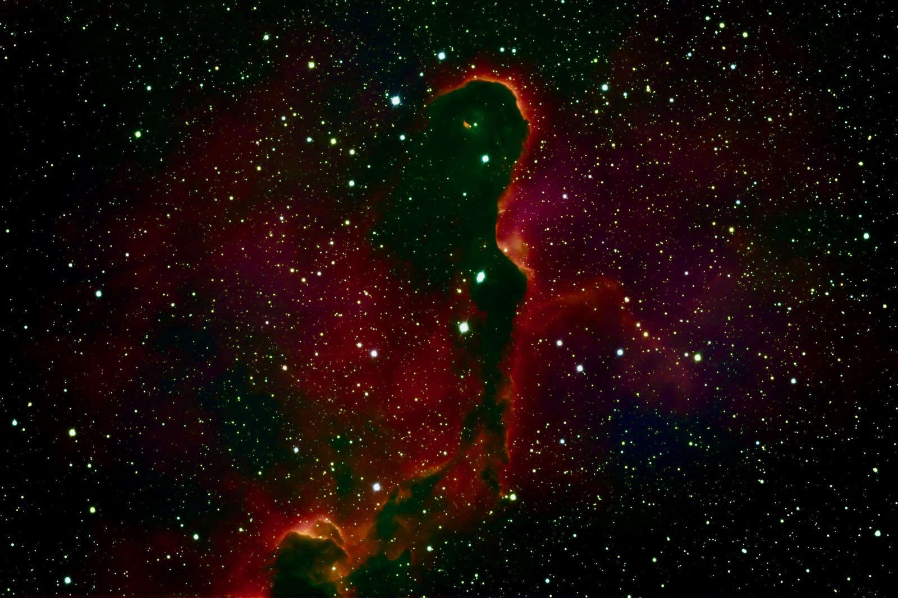

# Iris — a robotic telescope you talk to



*IC 1396A, the Elephant's Trunk — 12.1 hours across four nights: 145
five-minute exposures through three narrowband filters. Nobody was in the
observatory for any of them.*

Text Iris the name of a nebula from your phone. Some clear night — maybe tonight,
maybe next week when the geometry is right — a roof in a backyard opens on its
own, a half-ton telescope wakes up, finds the target, and spends the dark hours
collecting photons that left their source before the pyramids were built. By
breakfast there is a finished picture on your phone, captioned with how many
frames survived the night's quality gate. Nobody was in the observatory. Nobody
was awake.

That is the whole idea: **a fully autonomous deep-sky observatory run by
conversation**, built on one stubborn principle — *measure it, or it isn't
true*. Every subsystem below exists because a measurement demanded it, and most
of them have caught at least one thing that "looked fine."

The pictures and the write-ups live at **[irisscience.org](https://irisscience.org)**:
a gallery, a lab notebook of about thirty science notes (linked throughout this
page), and a live tab showing what the observatory is doing *right now*, down to
which state of its night state machine it is standing in.

---

## Hubble's experiment, a century later

In October 1923 Edwin Hubble found a Cepheid variable on a plate of the
Andromeda nebula, timed its 31.4-day pulse, and from Henrietta Leavitt's
period–luminosity law measured the distance to another galaxy for the first
time. In the autumn of 2026 Iris ran the same measurement on the same star.

- The star went into the queue on October 8 as a one-hour *monitor* target with
  its period attached. From then on the planner gave it an hour near the zenith
  on every clear night, the frames were calibrated and measured against Gaia
  comparison stars each morning, and the pipeline's own coverage rule decided
  when the curve was complete.
- Twenty-two nights caught the whole cycle: a 1.1-magnitude swing, the first
  maximum, the long decline, and a second climb of a full magnitude in two
  nights. The fitted curve's predictions for coming nights were kept and tested;
  three of four landed within a few hundredths, and the one miss is the most
  instructive line in the note.
- Leavitt's law, as calibrated by Hubble Space Telescope parallaxes, turns the
  period and the mean brightness into **669 kpc, 2.18 million light years**,
  against 2.54 accepted — within a fifth with one star, one filter and a
  17-inch telescope. Hubble, with the 100-inch, got a factor of three too close;
  the difference is a century of calibration, not the glass.
- The nightly measurements are AAVSO-grade (calibrated, saturation-guarded,
  airmass on every record, obstructed frames dropped) and written in the
  association's format for upload.

→ [Hubble's Star, a Century Later](https://irisscience.org/#hubble-v1-distance)
· [First light curves: Hubble's star and three Cepheids in Cassiopeia](https://irisscience.org/#cepheids-first-curves)
· [Three targets a night](https://irisscience.org/#three-slots) (how the hour was found)

---

## Neural networks trained on this sky

There is no clean reference image of the sky, so every network below
manufactures its own training signal from this telescope's own stacks, runs on
the observatory's GPU box, and is held to the same rule as everything else:
**nothing is ever measured from a network's output.** Every number quoted
anywhere comes from the calibrated linear stacks.

| Network | What it learns | Note |
|---|---|---|
| **Noise2Noise denoiser** | A U-Net trained on pairs of noisy stacks of the same field, no clean target ever seen. Runs every morning on the night's stacks; display only. | [Learning to denoise without ever seeing a clean image](https://irisscience.org/#noise2noise) · [The first denoise worth showing](https://irisscience.org/#n2n-first-result) |
| **Learned deconvolution** | Each stack is blurred a second time with its own measured kernel and the network learns to take that blur back off. It does not paint pixels: for every pixel it decides where the light came from and sends it back, so light is moved, never made, and stars go from 7.5 to about 4 px with no rings. Now the default sharpening on every morning render. | [Learning to undo the blur: a network that moves light](https://irisscience.org/#learned-deblur) · [Deconvolving Stephan's Quintet](https://irisscience.org/#quintet-deblur) (the hand-rule version it replaced) |
| **Star / nebula split** | A U-Net that takes a narrowband plane and returns it without its stars; the stars are the difference. Trained on real backgrounds with known stars injected from the field's own star profile. On a field it had never seen it lifted 338 of 358 stars cleanly. | [IC 410 without its stars](https://irisscience.org/#starless-ic410) |
| **Two language models** | An open-weight vision-language model on the observatory's own computer reads the picture and the measured record and drafts the gallery entry in the house voice; a second model from a different lab checks it for errors. Nothing leaves the building. | [Who writes the caption](https://irisscience.org/#machine-caption) |

---

## Other things Iris has actually done

- **Measured a redshift with no spectrograph.** The four distant members of
  Stephan's Quintet recede fast enough that their hydrogen glow lands inside a
  3 nm filter built for sulfur; the foreground galaxy's does not. 56 times the
  noise in NGC 7319, nothing in NGC 7320.
  → [Five galaxies that only look like neighbors](https://irisscience.org/#quintet-redshift)
- **Identified an asteroid that wandered through a frame.** A rainbow of
  dashes under NGC 1055 tracked at 32.6 arcseconds an hour; solved against
  Gaia, it sat 1.3 arcseconds from where JPL put 464 Megaira.
  → [A visitor in the frame](https://irisscience.org/#asteroid-megaira)
- **Detected an exoplanet.** A 7-hour run on HAT-P-32 caught the transit of
  HAT-P-32b; the blind search ranked it first of 622 stars.
  → [Finding a planet by watching a star get 2% fainter](https://irisscience.org/#transit-search)
  · [A search that finds nothing looks exactly like a search that works](https://irisscience.org/#injection)
- **Decides for itself when a target is done and which filters to shoot.**
  A target is retired when its stack has stopped improving *and* every filter
  holds its minimum of good frames; each night's filter ratio goes to whatever
  the stack is shortest of, weighted by noise, seeing and moon. Live since
  November 2026; the first noon retired two targets.
  → [Two decisions the telescope now makes by itself](https://irisscience.org/#auto-stop-filters)
- **Fills the whole night.** Trees bound the sky at 60° west and 48° northeast;
  the planner fits three targets around them, and a light-curve target can ask
  for a single hour.
  → [Three targets a night](https://irisscience.org/#three-slots)
- **Knows where focus will be before it looks.** 580 autofocus runs showed every
  filter's focus follows temperature along a line, about 80 steps per degree;
  each filter block now starts at the model's prediction.
  → [Telling the telescope where focus will be](https://irisscience.org/#focus-seed)
- **Fixed its own color from the stars.** The camera records a fifth more green
  than red or blue for a white star; a few hundred field stars now set the
  white balance of every broadband render.
  → [Why the galaxy came out green, and how the stars fixed it](https://irisscience.org/#star-white-balance)
- **Caught a space station with a $25 camera.** The driveway camera knew the
  pass from that morning's orbital data, armed itself and recorded Tiangong
  through cloud on a night the roof never opened. The same camera is
  plate-solved to 1.5 px and called a real storm 25–40 minutes before the
  weather API.
  → [The $25 camera that caught a space station](https://irisscience.org/#satellite-tracker)
  · [A security camera as a scientific instrument](https://irisscience.org/#skycam)
- **Caught its own tooling lying.** The FITS headers showed the guider's dither
  silently dead in one axis for months; the mount was exonerated by direct
  measurement and the dither now runs through the mount's native API.
  → [Missing on purpose](https://irisscience.org/#dither)
- **Hears and watches its roof.** Every roof move is fingerprinted by sound and
  by a watt-by-watt power trace; a live stall watchdog cut motor power on a
  real gear-didn't-engage event.
  → [Teaching the observatory to hear its own roof failing](https://irisscience.org/#roof-sentry)
  · [The camera that has to be right about the roof](https://irisscience.org/#vision-safety)
- **Weighed a cluster's age, measured its own optics, and worked out what its
  seeing actually depends on** (850 hPa wind and humidity, not the jet stream).
  → [M13's color–magnitude diagram](https://irisscience.org/#hr-diagram)
  · [What shape is a star?](https://irisscience.org/#psf)
  · [Has anything changed, or was it just a bad night?](https://irisscience.org/#optics)
- **Put a status light on the nightstand** so the owner stops unlocking a phone
  at 2 a.m.: a five-centimeter screen that can do nothing but show the frame
  counts and the sky.
  → [A telescope status light for the nightstand](https://irisscience.org/#nightstand-display)

And one essay with no telescope time in it:
[What a year of a great telescope costs, and who pays it](https://irisscience.org/#telescope-cost).

---

## How a night works

1. **Noon** — the conductor's clock makes the decision: every queued target is
   scored by visibility above the measured tree line, air mass, priority and
   the moon, the night is cut into up to three slots, each slot's filter ratio
   is chosen from the frames already on disk and the seeing forecast, and the
   plan is journaled and posted. Disk space on either machine is a stopping item.
2. **Pre-sunset** — weather, safety flags and a fresh camera read are checked
   again; the N.I.N.A sequence is generated from the plan and compared, field
   by field, with what was announced. A mismatch refuses the file rather than
   the night.
3. **Roof open** — only after two cameras agree the scope is parked. The two
   hardware laws are absolute and enforced in code: *the roof never moves unless
   the scope is confirmed parked; the scope never moves unless the roof is
   confirmed open.* Since September 2026 the roof's position is read from an
   AprilTag on the moving truss by a second camera that needs no light, and
   the inside camera may only veto.
4. **The run** — cool, slew, plate-solve, seed the focus from the temperature
   model, autofocus, then light frames until astronomical dawn with a dither
   between subs. Every incoming frame is measured (FWHM, star count, sky) and
   streamed to the chat and the public live page.
5. **Dawn** — flats, park, roof close, dehumidifier on, summary posted. The
   GPU box pulls the night's frames, stacks, denoises, deconvolves, white
   balances and crops, and pushes the picture to a phone. A converged target
   gets a final render with its own quality check, a drafted caption, and a
   chat card that publishes to the gallery on the word `approve`.

The whole night is driven by a formally specified state machine — a data
table with every state × event pair tested, including a 1,944-case sweep that
proves the roof invariant over the entire sensor-evidence space. It shadowed
real nights read-only through the summer; since October 2026 it decides both
hardware invariants and plans the nights, and the legacy scheduler only carries
out what it says. A hold rings the phone until acknowledged, and a held
observatory reminds its owner once a day until released. Deploys are gated the
same way: the observatory pulls a `release` branch that only advances when CI
is green, so a broken push can never reach the roof controls.

---

## Talking to it

The chat runs on a self-hosted web server (excellent from a phone) with live
job cards, frame previews and cancellable long commands. A taste:

| Command | What happens |
|---|---|
| `image <dso>` | Queue a target; it is scheduled when its night comes, typed as galaxy or nebula on the way in |
| `tonight` | Tonight's plan: slots, hours, filters, weather, moon, visible ISS passes |
| `suggest` | Ranked showpieces worth adding, scored on the next 30 nights' visibility, field fit and moon; nothing is queued without an `image` |
| `stats` / `latest` | Per-frame quality plots; the most recent sub, annotated |
| `snr <dso>` | Stack-convergence curves per filter — is this target *done*? |
| `filters <dso> … for N` | An explicit filter plan that expires after N imaged nights |
| `reopen` / `hold` / `moon` / `maxhours` / `type` | The queue's fields as commands; no hand edits of the JSON |
| `process <dso> <recipe>` | Calibrated LRGB / HALRGB / HOO / SHO stack on demand, with palette gain and tone |
| `aavso <dso>` | The monitor's light curve in AAVSO Extended Format |
| `optics` | Per-star fits → FWHM heatmap, coma, tilt and collimation scores from one frame |
| `transit <star>` | Photometric time series and box-fit transit search |
| `overhead` | Aircraft over the roof right now, from the public ADS-B feed |
| `approve <dso>` / `reject <dso>` | The one word that publishes a drafted gallery entry |
| `safe!` / `stop!` / `resolve!` | The human veto, always |

---

## The parts

| Subsystem | What it does |
|---|---|
| `iris/conductor` | The machine-as-data state machine: journal, guards, the clock that plans the night, the bell that rings the phone |
| Scheduler | Carries out the conductor's plan: generation, verification, imaging, shutdown |
| Vision safety | AprilTags on the scope and the roof, read by two cameras; the north camera decides the roof, the inside camera may veto |
| Frame watcher | Live FWHM / star count / sky analysis of every sub as it lands |
| Sequence generator | Patches N.I.N.A templates with target, coordinates, per-filter gain, focus seed and the planned filter ratio, then verifies the file against the announcement |
| Stacker | Calibration matched to the lights' gain, quality gate, astroalign registration in a process pool, tiled sigma-clip that levels frames to a common sky (skipping that step measured **8× worse than the photon limit**) |
| Color pipeline | Shared reference and shared stretch across filters, Hα excess into LRGB, palette gain, star-neutral palettes, star white balance, color planes matched to one star width, four-stage background removal |
| Photometry | Nightly light curves against Gaia comparison stars, phase coverage, Leavitt-law distance, AAVSO export |
| Auto-stop, filter advisor, suggestions | The three decisions that used to need a person every few days |
| Audio + current sentry | Spectrogram matching and power-signature analysis of every roof move, plus the live stall watchdog |
| Sky cameras | An all-sky fisheye and a plate-solved consumer cam: cloud cover, rain detection, satellite passes, limiting magnitude |
| Publisher | The live page, the target board, final renders with QC, drafted captions, the approve gate, the gallery |
| `nn/` | Noise2Noise, learned deconvolution and the star split: training and nightly inference on a DGX Spark |

Hardware: PlaneWave CDK17 on an L-500 direct-drive mount, a 61 MP full-frame
mono camera with a 7-filter wheel, a sliding roof driven by a gate-opener motor,
TP-Link/Shelly switched power, cameras and a microphone as senses, an NVIDIA
DGX Spark for the networks — all behind Tailscale, with the public face served
through a Cloudflare tunnel.

---

## A word of honesty before you clone

This is open source, but it is not (yet) a product. Iris is one specific
observatory — one roof, one mount, one camera, one tree line, and a hundred
constants measured against them. Paths, wheel positions, park coordinates,
horizon profiles and marker positions all assume *this* backyard. You could
absolutely build your own from these pieces, and the code tries hard to keep
its reasoning legible for exactly that reader — but expect to bring a measuring
instinct rather than run an installer. The conductor is the part that has
already crossed over: a machine defined as data, separated from the
measurements that feed it, which another observatory could actually adopt.

---

## Setup

```bash
# Install uv (once)
curl -LsSf https://astral.sh/uv/install.sh | sh

# Clone the repo
git clone https://github.com/taylorhogan/srt.git
cd srt

# Create and activate virtualenv (Python 3.13+).
# Use uv's default .venv path — `uv pip` auto-discovers it; a differently
# named venv is silently ignored and parts of the pipeline degrade quietly.
uv venv --python 3.13
source .venv/bin/activate      # Linux / macOS
# .venv\Scripts\activate       # Windows (what the observatory itself runs)

# Install dependencies
uv pip install -r requirements.txt

# Create private config (required before running anything)
cp configs/config_blank_private.py configs/config_private.py
# Then fill in API keys/tokens in config_private.py
```

## Running

```bash
# Start both the chat server and the scheduler together
python end_points/start_srt.py

# Or run individually:
python end_points/scheduler_server.py   # Nightly state machine
python cmd_processing/social_server.py  # Web chat server
```

Operations, alerts and what to do about each are in `docs/HANDBOOK.md`; what
dies when each account lapses, and how to restore, in `docs/SUCCESSION.md`.

---

## Appreciation

This work rests heavily on others:
- [Astropy](https://www.astropy.org) / [Astroplan](https://astroplan.readthedocs.io) / [astroquery](https://astroquery.readthedocs.io) — and the [SIMBAD](https://simbad.cds.unistra.fr) service at CDS behind it
- [Gaia](https://www.cosmos.esa.int/gaia) (ESA) — every comparison star and every astrometric solution
- [N.I.N.A](https://nighttime-imaging.eu)
- [astroalign](https://astroalign.quatrope.org) / [SEP](https://sep.readthedocs.io) / [photutils](https://photutils.readthedocs.io)
- [python-kasa](https://github.com/python-kasa/python-kasa) — vendored in this very repo to switch the observatory's power
- [Open-Meteo](https://open-meteo.com) and the US National Weather Service — forecasts, no key required, asked every single day
- [Skyfield](https://rhodesmill.org/skyfield/) — satellite passes and ephemerides
- [OpenCV](https://opencv.org) and [AprilTag](https://april.eecs.umich.edu/software/apriltag) — the vision safety system's eyes
- [librosa](https://librosa.org) — the roof sentry's ears (mel spectrograms)
- [PyTorch](https://pytorch.org) — every network above
- [Ollama](https://ollama.com), Gemma and Qwen — the caption writer and its critic, on the observatory's own computer
- [FastAPI](https://fastapi.tiangolo.com) / [uvicorn](https://www.uvicorn.org) — the chat server
- [Noise2Noise](https://arxiv.org/abs/1803.04189) (Lehtinen et al., 2018)
- [AAVSO](https://www.aavso.org) — the variable-star charts, the comparison sequences and the place the light curves go
- [Allsky](https://github.com/thomasjacquin/allsky)
- [Claude](https://claude.com/claude-code) (Anthropic) — pair programmer for much of what's described above, from the stacking mathematics to the state machines to this README

---

*Iris Observatory · Social Robotic Telescope · nobody is awake, and the roof
just opened anyway*
